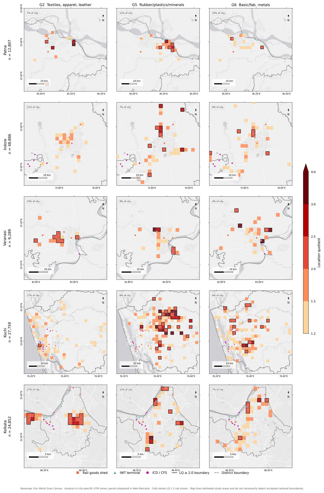

# MFAI: Multimodal Freight Accessibility for manufacturing MSMEs

Code for **"Multimodal Freight Accessibility and the Limits of Spatial
Targeting for Locational Disadvantage: Manufacturing Enterprises in Five
Indian Cities"**, by Ananya Saha, Suprava Mishra and Agnivesh Pani. Accepted
for presentation at the 106th Annual Meeting of the Transportation Research
Board (Washington, D.C., January 2027).

> Freight policy in India increasingly *targets places*: industrial
> corridors, logistics parks, cluster schemes. That assumes freight
> disadvantage is spatially concentrated enough to target. This project
> measures access to road, rail, inland-waterway and ICD freight
> infrastructure for **123,591 manufacturing MSMEs** in Patna, Varanasi,
> Indore, Kochi and Kolkata, and tests whether the disadvantaged ones
> actually cluster.


<sub>Figure 6 of the paper: where three manufacturing groups concentrate (empirical-Bayes location quotients on a 2 km grid, 1 km for Kolkata), with freight terminals overlaid.</sub>

## Main findings

- **Access varies far more within cities than between them.** Between-city
  differences explain 24.3% of enterprise-level variance in MFAI-land,
  industrial group 1.0%, and micro-location the remaining 74.7%.
- **Container access is the binding constraint in three of five cities.**
  The ICD is the lowest-scoring land mode in Patna, Indore and Kochi.
  Kolkata scores highest (0.893) and Patna lowest (0.728).
- **A composite index can hide mode-specific deficits.** The bottom decile
  of MFAI and the bottom decile of an individual mode do not always pick
  out the same enterprises (`06_mode_severity_masking.py`).
- **Disadvantage rarely forms compact, targetable zones.** Low-access
  enterprises cluster by construction, because access varies smoothly with
  distance. Against a spatial null, they are more concentrated than chance
  only in Kochi and Varanasi. In Patna and Indore they are significantly
  *less* concentrated than an arbitrary group of the same size, because
  they sit in the sparse periphery.

## Method

```
Udyam registry ─► Stage 0  clean, ISIC Rev.4 → 8 manufacturing groups
                  Stage 0.5 flag geocoder-fallback coordinates (nothing dropped)
OSM roads ──────► Stage 1  vertex-level road graph → Dijkstra distance to the
terminals ──────►          nearest major road, rail goods shed, IWT terminal, ICD
                  Stage 2  access_m = T_m / (T_m + d_m), externally anchored T_m
                           MFAI = weighted geometric mean; MFAI-land = road, rail, ICD
GHSL, VIIRS ────► covariates: built-up density (300 m focal), night-time lights
                  analysis  variance decomposition · NB agglomeration models ·
                            HDBSCAN + spatial null models · location quotients
```

A few design choices matter for reproducing the results:

- **Graph over all vertices, not segment endpoints.** Endpoint-only graphs
  gave snap connectors that correlated with built-up density
  (ρ = −0.22) and inflated road distances 1.67× against straight-line
  distance. The vertex-level graph cuts the median connector to about 12 m
  and the inflation to 1.33×.
- **Reference distances are fixed externally** (2 km for road, 50 km for
  the other modes), so scores are comparable across cities. All 625
  combinations are tested in `S3_reference_distance_sweep.py`.
- **Geocoder artefacts are flagged, never deleted.** Coordinates holding at
  least 20 enterprises that span at least 5 pincodes (city-centroid
  fallback) or at least 8 ISIC divisions (pincode-centroid fallback) are
  excluded at load time. This removes 23.8% of records, unevenly by city
  (4.9% in Kolkata, 36.1% in Kochi). `S1_threshold_sensitivity.py` shows
  index means stay stable across thresholds 4–12.

## Repository layout

```
src/mfai/          the package
  config.py        study constants and locked parameters
  paths.py         every file location, from MFAI_DATA / MFAI_RESULTS
  io.py            load_city(): the only correct way to read the analysis sample
  clean.py         Stage 0 / 0.5
  network.py       Stage 1
  index.py         Stage 2
  rasters.py       GHSL and VIIRS sampling
  pipeline.py      runners and summary checks
scripts/run_pipeline.py
analysis/          one script per manuscript section (table below)
tests/             reproduction checks against the published numbers
results/published/ the tables as published, for comparison
```

| Script | Produces |
|---|---|
| `01_descriptives.py` | working descriptive tables |
| `02_spatial_extent.py` | Table 6, Figure 3 (truncation radii) |
| `03_variance_decomposition.py` | Table 10 |
| `04_ntl_validity.py`, `05_ntl_robustness.py` | Section 4.6 (night-lights validity, monocentric control) |
| `06_mode_severity_masking.py` | Tables 8–9, Figure 5 |
| `07_agglomeration.py` | Table 12, Supplementary S11 |
| `08_targetability.py` | Table 13 (HDBSCAN with Null A and Null B) |
| `09_targetability_frontier.py` | Figure 8, Table 16 |
| `10_nullB_pooled_P5.py`, `12_threshold_checks.py` | robustness of the null models |
| `11_fig7_zones.py` | Figure 7 |
| `13_zone_profiles.py` | Tables 15, 17 |
| `14_commodity_extension.py` | Table 11 and the commodity sorting tests |
| `15_estate_validation.py` | Supplementary S9 |
| `16_figures.py`, `18_fig6_lq_maps.py` | Figures 1–6, S1–S2 |
| `17_tables.py` | all main-text and supplementary tables (LaTeX + CSV) |
| `S1_…`, `S2_…`, `S3_…`, `S4_…` | Supplementary S1–S4 |

## Running it

```bash
git clone https://github.com/ananya-fml/mfai-freight-accessibility
cd mfai-freight-accessibility
pip install -e .

export MFAI_DATA=/path/to/MFAI_archive        # see data/README.md
python scripts/run_pipeline.py                 # stages 0–2, all cities
python analysis/17_tables.py                   # regenerate the tables
pytest -q                                      # check against the paper
```

Outputs go to `results/`, or to `MFAI_RESULTS` if set. The analysis scripts
need only `02_analysis_data/` and the terminal layers. The pipeline,
`07_agglomeration.py` and the map figures also need the road networks and
rasters.

## Reproducibility

Run against the data archive, `17_tables.py` writes all 23 published table
exports, and every CSV matches `results/published/tables/` cell for cell.
Fifteen are **recomputed from the data**: Tables 1–2, 4–13, S1 and S4a–b.
The other eight are marked `STORED` in the script and hold values
transcribed from earlier runs: Table 3 (graph statistics), Table 14
(agglomeration), Tables 15–17 (targetability), S6 and S9a–b. `pytest`
checks the sample sizes (Table 2), mean MFAI-land (Table 6) and the
variance decomposition (Table 10).

Things to know before rerunning:

- **Targetability (Tables 15–17) comes from an earlier version of the
  analysis.** That version used city-specific bottom deciles and 100 null
  draws. `08_targetability.py` now treats the pooled P10 (0.7065) as primary
  and uses 9,999 draws. Its city-specific sensitivity run reproduces the
  published Kochi and Varanasi rows (same zone counts and in-zone shares) but
  not Patna, Indore or Kolkata exactly.
- Table 14 and S6 need the road networks: rerun `07_agglomeration.py` and
  the pipeline report to recompute them.
- The industrial-estate comparison is reported as unavailable in the paper.
  OSM industrial land use covers only 0.06–3.47% of enterprises, so only
  Indore and Kolkata could be compared. The code stays in for
  transparency.
- `18_fig6_lq_maps.py` and `S2_hdbscan_sweep.py` use the canonical loader.
  The published Figure 6 and S2 were made with an earlier loader that kept
  two extra Indore enterprises (the figure's label reads n = 48,886).
- Random seeds are fixed in the null-model and permutation scripts, but HDBSCAN
  results can shift slightly across library versions.

## Data

Enterprise records come from the Udyam registry and are **not
redistributed**. See [`data/README.md`](data/README.md) for the expected
layout, sources and the artefact filter. All other inputs are public: OSM,
GHSL, VIIRS and the terminal inventory in Supplementary S4.

## Citation

See [`CITATION.cff`](CITATION.cff). Code is MIT-licensed.

Contact: Ananya Saha, Department of Civil Engineering, IIT (BHU) Varanasi.
